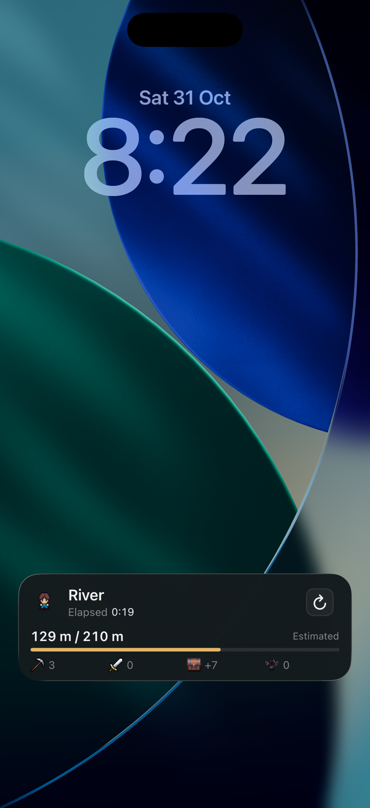

# Four metrics in one row

Source `216718399` changes only the native widget presentation. Pickaxe/tasks, sword/kills, summary chest/resources and Carl/reaps now occupy four equal-width groups in one row. All numbers share the same caption font, weight and secondary color; icons share a 16-point box. Visible metric words are removed. Accessibility labels and values retain their meaning and scope. Resources retain the existing background gain plus sign.

The incremental native build succeeded and was installed in the same owned prototype app, **1.5.9 (187)**. The actual iPhone 17 Pro simulator Lock Screen on iOS 26.4.1 showed 129 / 210 m, elapsed 0:19, and the four values 3, 0, +7, 0 without overflow. Refresh was tapped on the real card; the elapsed origin, distance bar and behavior were not changed by this revision. The updated card is left visible on the Mac.

The expanded Dynamic Island uses the same `SnapshotValues` view, but its actual rendering was not captured: the rapid resume-to-Home attempt had no active Island to expand. Small-family rendering and physical hardware were not checked in this formatting pass. Existing functional tests were not replayed for this visual-only change. No Unity export, C# change, save logic change, version change or upload occurred. Earlier integration evidence remains unchanged.
