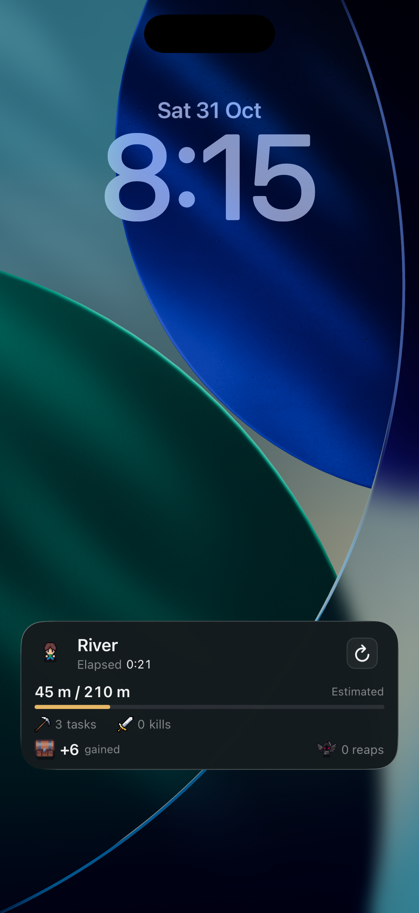

# Actual Unity Live Activity integration — 2026-10-31

The actual Unity-generated simulator app now shows the restored dark-teal card with native numeric elapsed time, distance/current effective cap, task and kill gains, the exact summary chest, resources and Carl/reaps. Refresh uses the native host in the background. The updated card is left visible on the Mac simulator. No version change, main merge, TestFlight upload or store deployment occurred.

[19-second continuous recording of the final card and two taps](numeric-refresh.mp4). The recording is trimmed at its ends and scaled to 720 pixels wide; there are no cuts between taps. The earlier `styled-lockscreen-first/second.png` images preserve the intermediate word-clock appearance. `styled-lockscreen-numeric.png` and the clip show the numeric-clock build before the final singular-label polish. `styled-lockscreen-final.png` shows the installed final build.

## Observed results

| Actual Unity app phase | First Refresh | Second Refresh |
| --- | --- | --- |
| Final numeric clock, PID 50906, source `2c32546c0` | 39 / 210 m, 2 tasks, 0 kills, +4 gained, 0 reaps | 49 / 210 m, 5 tasks, 1 kill, +10 gained, 0 reaps |
| Full resume validation, PID 33392, source `764d4f567` | 143 / 208 m, 28 tasks, 7 kills, +53 gained, 0 reaps | 163 / 208 m, 37 tasks, 10 kills, +69 gained, 0 reaps |

These are observed screen values, rounded for display. Native receipts retain precise sampled values and timestamps. Both phases ran with application state 2 (background) before and after every intent. The Lock Screen stayed visible. Within each phase, source ID and background origin remained identical across taps, as did every saved game-file hash, Watch-cache hash and settlement-file hash. The numeric timer advanced independently from the origin; Refresh did not reset it. Gains are estimates from the cached trajectory, not earned inventory.

The subsequent actual foreground resume in PID 33392 produced exactly one new settlement for 198.001104 seconds. Observed run deltas were 54 tasks, 15 kills and 121.81049449443753 resources. UIKit reported active before the managed resume ran. See `resume-result.json`, `settlement-native-receipt.log` and the before/after state receipts. A startup settlement from the preceding fixture exists in that console; the count changed from one to two, so only one belongs to the measured resume. Later normal foreground deaths/restarts are excluded from this interval.

Portrait restart and landscape Settings input worked in the actual game. `portrait-input-restart.png`, `landscape.png` and `resumed.png` capture these game surfaces separately from the portrait Lock Screen.

## Build and checks

- Unity 6000.6.0f1, Xcode simulator SDK 26.4; iPhone 17 Pro simulator runtime 26.4.1 (23E254a).
- Same owned bundle `com.blindsidedgames.echoes.background.prototype`, version **1.5.9 (187)**; source `9fdaf86b6` (numeric clock plus singular-label polish). Xcode build succeeded. `build-source-receipt.json` records binary hashes and matching generated native source/art hashes. Host and widget AppIntents metadata both include the refresh intent.
- Existing estimator EditMode suite: **13 passed**. Existing continuation PlayMode suite: **5 passed**. The meaningful brief-resume regression first failed against the old implementation; `brief-resume-before.xml` records that expected failure, not a final failure.
- Production Swift decoder checks: **14 passed** for six/eight-column compatibility, cumulative gains, invalid input, restart pauses and expiry. The retained distance sampler checks: **21 passed**. Boundary tests cover reaps; a reap during the measured suspended Unity interval was not observed.
- The simulator's Unity pause/resume scheduling warning can still appear. The UIKit gate preserved background state and deferred settlement until actual foreground in the measured interval. Editor tests do not exercise UIKit.

## Fixture and limits

This is the guarded prototype demo with ten fictional calibration samples in a real Unity run. It demonstrates integration, not forecast accuracy. Only the owned simulator app's fixture was changed; its original data is backed up locally in `Artifacts/LiveActivityRefreshIntegration20261031/prototype-data-before.tar.gz` and the later pre-demo saves directory. The fresh QA fixture is retained for the live preview, not restored under the running app.

The primary checkout retains its original HEAD and exact user diff. Of 228 pre-recorded original player-directory files, 226 match; only the generated `TestResults.xml` report and Unity Editor Analytics values cache changed. All progression files remain unchanged.

Physical devices, locked-device authentication/Face ID, real always-on cadence, older iOS runtimes, cold-host Unity startup, Dynamic Island interaction, small-family rendering and Watch rendering were not validated in this final integration pass. The earlier standalone native harness has separate evidence and does not prove those Unity behaviors. Existing time-format and manual-refresh evidence was left unchanged. The unrelated synthetic lab app was removed from this owned simulator, leaving the real styled card.
