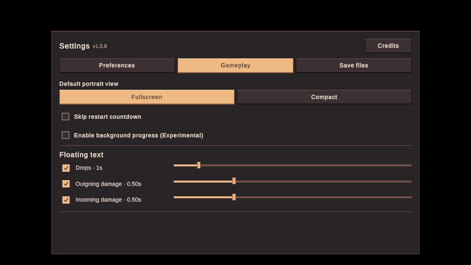
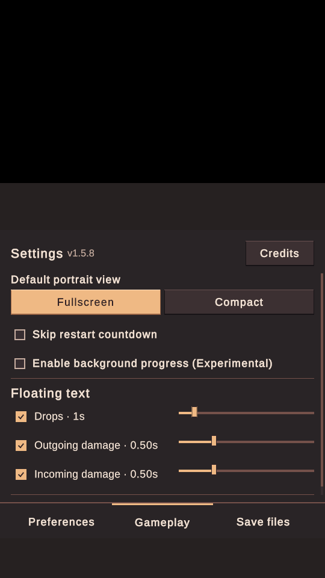

# Internal iPhone and Watch TestFlight build 187

The normal game, Watch companion, and Live Activity extension were built from
`ff3639d031a190110246f99ab1af540969aa5812` and uploaded as **1.5.9 (187)** to
existing App Store Connect app `6749265146`. Apple accepted the upload at
2026-10-31 06:45:41 UTC and initially reported **Processing**. App Store Connect
subsequently showed **Testing**, with the existing Internal group assigned
(three testers). The approved What to Test instructions were saved. The final
build ID is `2143b5bc-6f13-45a1-b948-020ae734e56b`. This verifies internal
availability, not installation or gameplay acceptance on physical hardware.

The build uses Unity 6000.6.0f1, Xcode 26.4.1, a fresh full DeviceSDK export,
IL2CPP arm64 for iPhone, Release native compilation, and Lz4HC compression.
`BuildModeConfig` Demo and Beta are both false. No synthetic save or demo launch
is enabled. `EOV_BACKGROUND_PROTOTYPE` makes the experimental setting available;
its PlayerPrefs fallback is zero, so background progress starts off disabled.
The Watch can still display actual foreground data with that setting off.
Android's build number remains 186; Android and Steam were not distributed.

The host, Watch app, and widget all report 1.5.9 (187). The Watch contains both
arm64 and arm64_32. Xcode cloud-managed Apple Distribution signing produced
matching team/app identifiers and `get-task-allow=false` for all three bundles.
The existing non-exempt-encryption declaration remains false. The Watch icon
uses the unchanged approved opaque 1024-pixel `Assets/Art/AppIcon.png`.

Apple first rejected the preparatory 1.5.8 package because that released version
train was closed and Unity's phone architecture had propagated to the Watch.
The corrected source uses 1.5.9 and sets the Watch target's `ARCHS` to
`$(ARCHS_STANDARD)` and `ONLY_ACTIVE_ARCH` to `NO`. Both actual binary slices and
the final distribution summary were checked before repeating Apple validation.
The corrected package passed validation. Apple also reported a nonblocking
missing vendor dSYM warning for UnityRuntime.framework; the game's matching
UnityFramework dSYM is present.

The existing protected warm lifecycle and read-only companion tests passed
2/2 with the prototype compile define. The warm test includes opting out,
backgrounding, and returning without estimated awards or rebuilding the run.
The actual Options prefab was rendered through landscape, portrait, and back;
the label stayed inside its button and the center hit the control. These are
focused editor UI checks, not a full phone or Watch hardware review.

The actual upload IPA was retained. All native UUIDs and TEXT section hashes,
including both Watch slices, and all serialized Data hashes match the reviewed
local IPA. Whole-package hashes differ because distribution packaging and
signing can vary; both hashes are recorded in the JSON.

The primary Mac checkout's HEAD and tracked user edits are unchanged. All
recorded progression files remain unchanged. Of 228 originally hashed files,
227 were unchanged; the sole change was a Unity Editor Analytics cache, which
was left in its normal updated state. The isolated build still uses the
previously recorded Sirenix/VoxelBusters import and assembly-reference
adaptations; private credentials and raw distribution logs stay outside Git.

The user approved the unchanged English TestFlight testing instructions after
the version correction was explained. The existing public 1.5.8 Library/store
notes were preserved. No public App Store submission, external tester changes,
or main-branch merge was performed by this preparation.
